# 📚 Ruby on Rails & React E-Learning & CBT Platform

[](https://www.ruby-lang.org)
[](https://rubyonrails.org)
[](https://react.dev)
[](https://tailwindcss.com)
[](https://www.postgresql.org)
[](https://redis.io)
[](https://github.com/mfarim/spring-elearning-react)
[](https://github.com/mfarim/fastapi-elearning-react)
[](https://github.com/mfarim/laravel-elearning)
[](LICENSE)

> 🇮🇩 [Baca dalam Bahasa Indonesia](README.id.md)
>
> 💎 **Ruby on Rails 8 & React 19 Edition** of the enterprise multi-tenant academic Learning Management System (LMS) and Computer Based Test (CBT) platform.

A full-featured, high-performance web-based **E-Learning** and **Computer Based Test (CBT)** platform engineered for managing modern academic learning activities between **Admin**, **Teacher**, and **Student**. Built with a decoupled cloud-ready architecture: **Ruby on Rails 8 API mode, React 19, Vite, and Tailwind CSS v4**, featuring stateless JWT authentication with admin impersonation, PostgreSQL 16 persistence, Redis cache, real-time candidate proctoring telemetry, and Excel batch processing.

---

## ✨ Key Features

### 👨‍💼 Admin Panel
| Feature | Description |
|---|---|
| **Dashboard** | Real-time statistics overview: teachers, students, classrooms, subjects, CBT metrics |
| **Teachers** | Full CRUD with automatic user account provisioning & NIP validation |
| **Students** | CRUD + classroom filtering + **📥 Excel Batch Import** (`.xlsx`) + Exam Cards Print |
| **Classrooms** | CRUD + homeroom teacher assignment + capacity & academic year management |
| **Subjects** | CRUD + subject code + credit units + assigned teacher mapping |
| **Announcements** | CRUD + multi-target broadcasting (All / Teacher / Student) + publish toggle |
| **Impersonation** | Instant one-click login as teacher or student for administrative debugging |
| **Security** | Stateless JWT tokens, BCrypt hashing, and role-based authorization |

### 👨‍🏫 Teacher Panel
| Feature | Description |
|---|---|
| **Dashboard** | Teaching metrics, scheduled examinations, active assignments, and recent activity |
| **Learning Materials** | CRUD + multi-type content (Document, Video, Text, Link, Audio) + student view tracking |
| **Assignments** | CRUD + deadline dates + instructions + submission grading with feedback |
| **CBT Examinations** | CRUD + duration timer + passing grade (KKM) + randomize questions/options + retry toggles |
| **Question Builder** | Multiple Choice (A-E), True/False, Essay + points allocation + **📥 Excel Import** |
| **Live Telemetry Monitor** | Real-time candidate status, question progress bar, and anti-cheat flag alerts |
| **Exam Hall Tickets** | Print ready-to-use official CBT student candidate cards with NIS barcodes |

### 👨‍🎓 Student Panel — Mobile-First Design
| Feature | Description |
|---|---|
| **Home Dashboard** | Responsive mobile drawer, upcoming exams countdown, active assignments, announcements |
| **Learning Modules** | Browse, read, and download structured course materials per enrolled subject |
| **Assignment Hub** | View assignment instructions + file upload dropzone + feedback review |
| **CBT Exam Room** | Fullscreen examination runner with countdown timer, anti-cheat detection, and auto-submit |
| **Grades & GPA Summary** | Subject average breakdown, progress bars, and passing grade pass/fail status |

### 🖥️ CBT Exam System Workflow
```
Exam List → Confirmation & Instructions → Secure Exam Runner
                                           ├── ⏱️ Synchronized Timer (auto-submit on expiry)
                                           ├── 🔒 Anti-Cheat Proctoring (fullscreen & tab change alerts)
                                           ├── 📍 Color-Coded Question Palette (answered / remaining)
                                           ├── 💾 Instant Auto-Save (on every option selection)
                                           └── 📊 Real-Time Proctor Telemetry (Live status push to teacher)
```

---

## 📸 Screenshots

### 🔐 Login Page
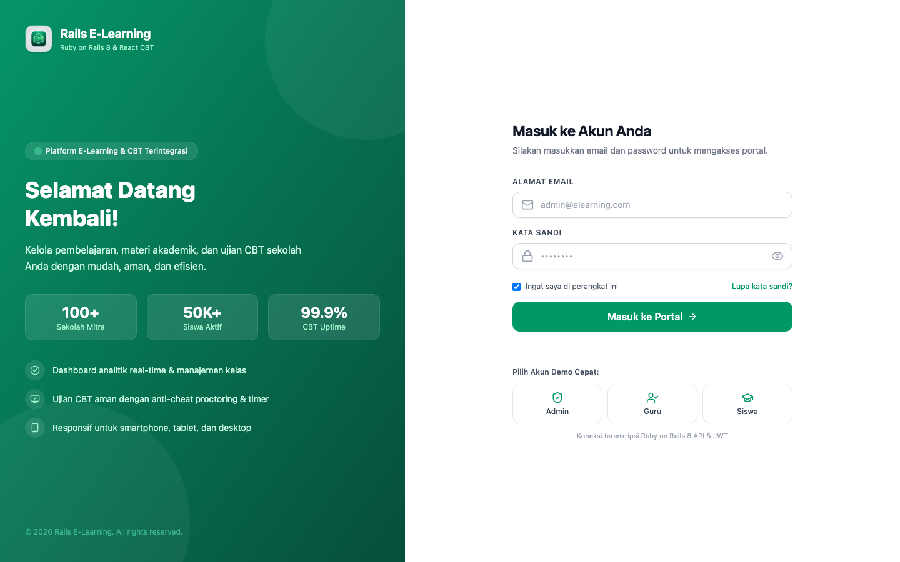

### 👨‍💼 Admin Panel
| Dashboard | Teachers Management |
|:---------:|:-------------------:|
| 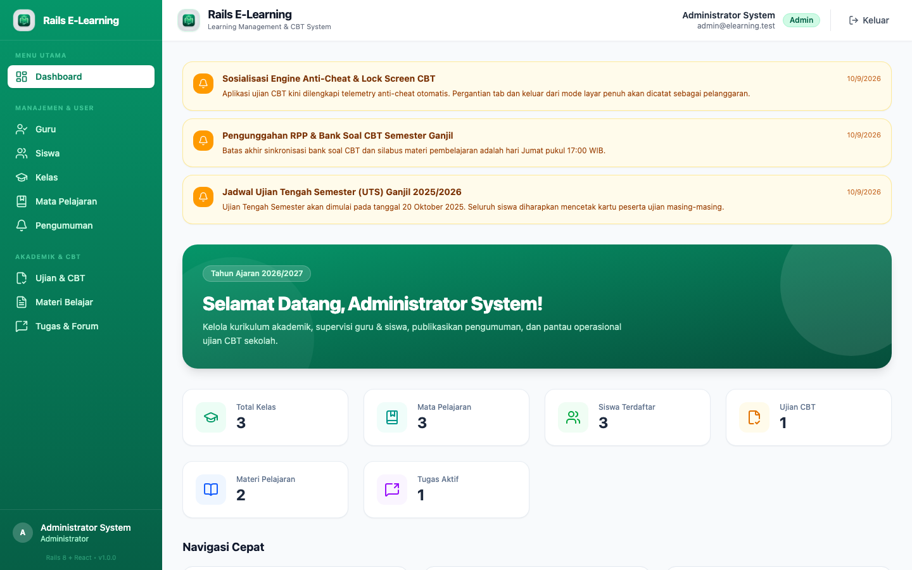 | 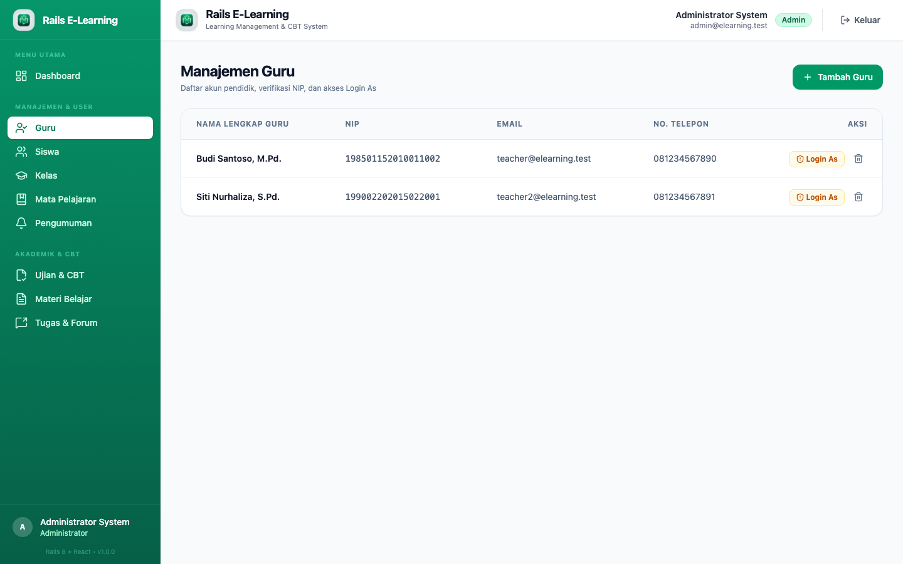 |

| Students Management | Classrooms Management |
|:-------------------:|:---------------------:|
| 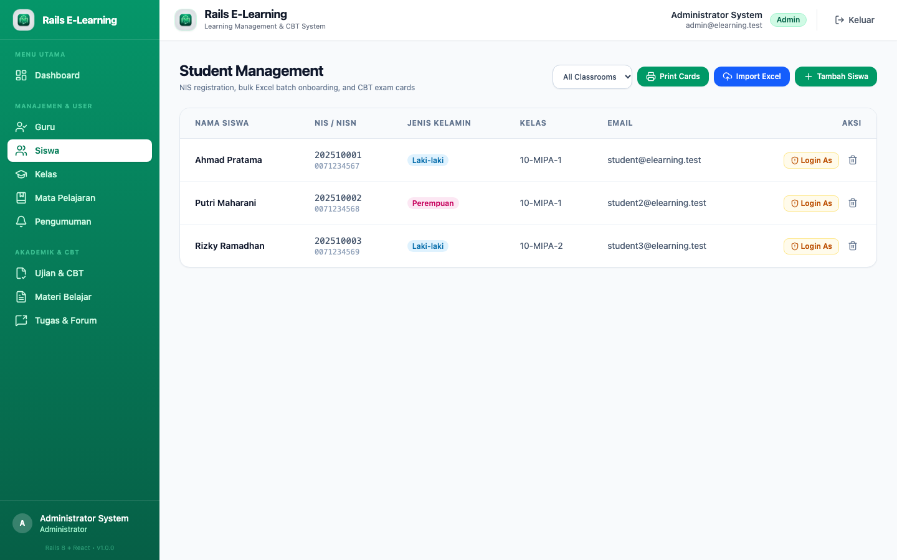 | 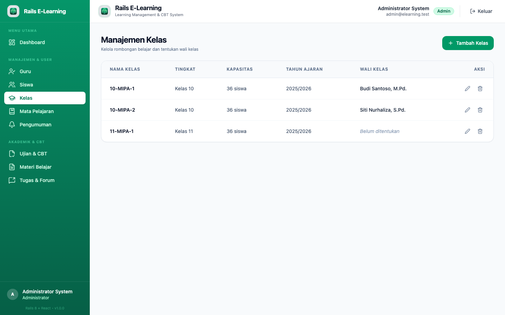 |

| Subjects Management | Announcements |
|:-------------------:|:-------------:|
| 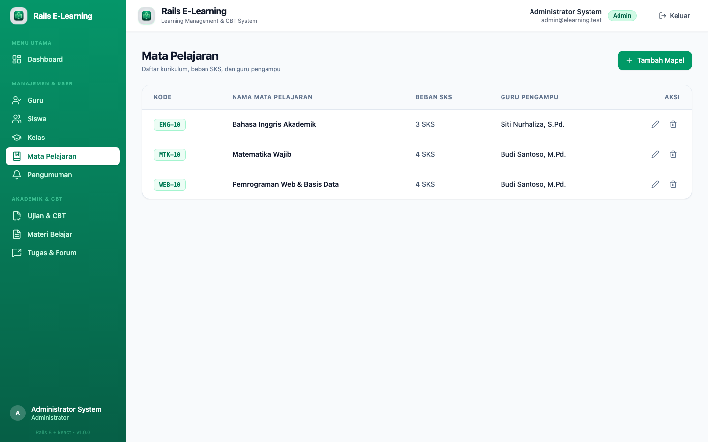 | 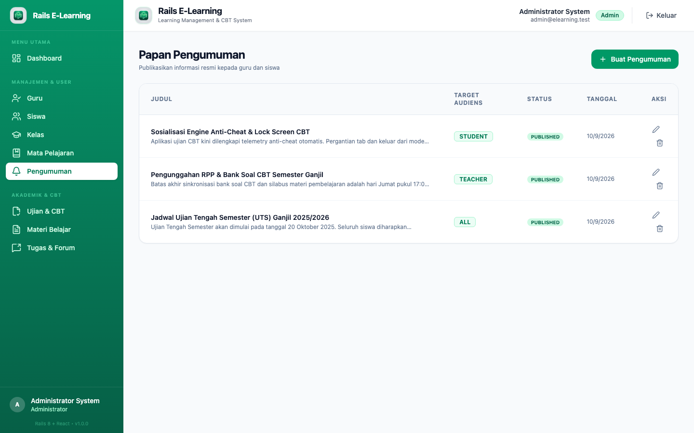 |

### 👨‍🏫 Teacher Panel
| Dashboard | Learning Materials |
|:---------:|:------------------:|
| 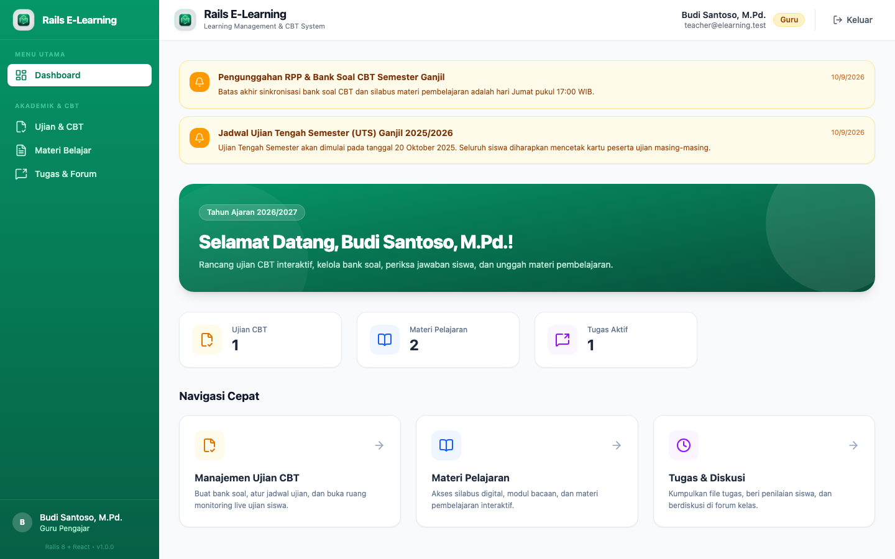 | 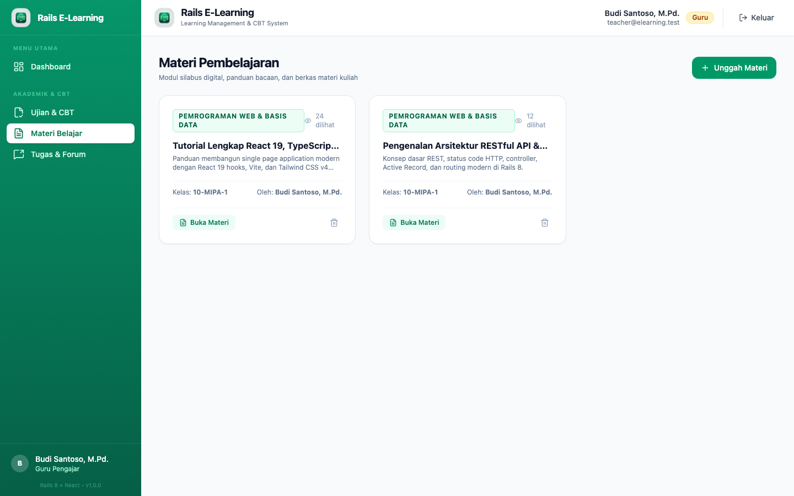 |

| Assignments Management | CBT Examinations |
|:----------------------:|:----------------:|
| 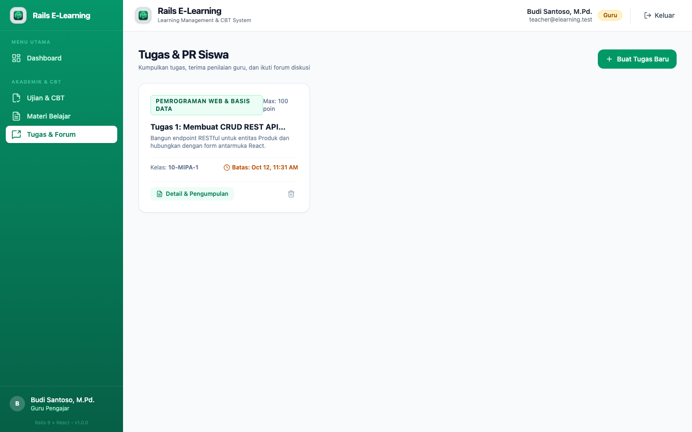 | 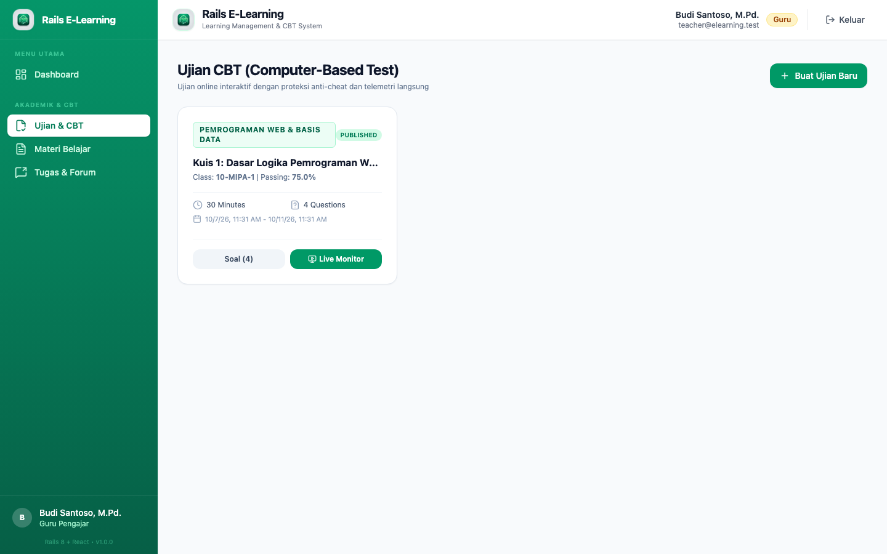 |

| Question Builder & Bank |
|:-----------------------:|
| 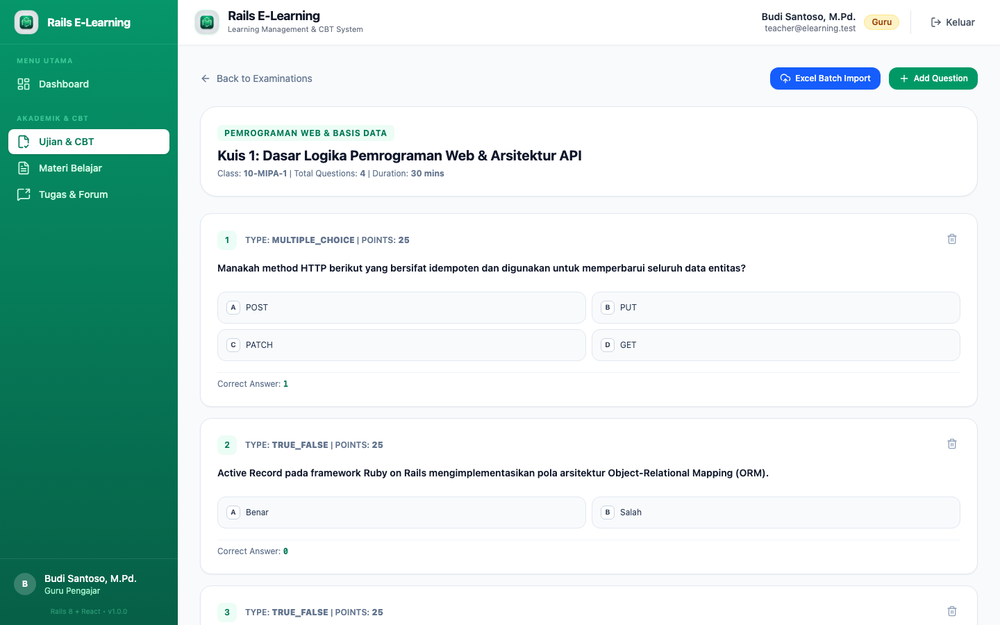 |

### 👨‍🎓 Student Panel (Mobile-First Design)
| Home Dashboard | Learning Materials | Assignments Hub |
|:--------------:|:------------------:|:---------------:|
| 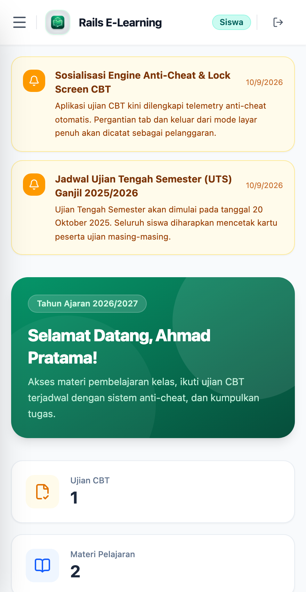 | 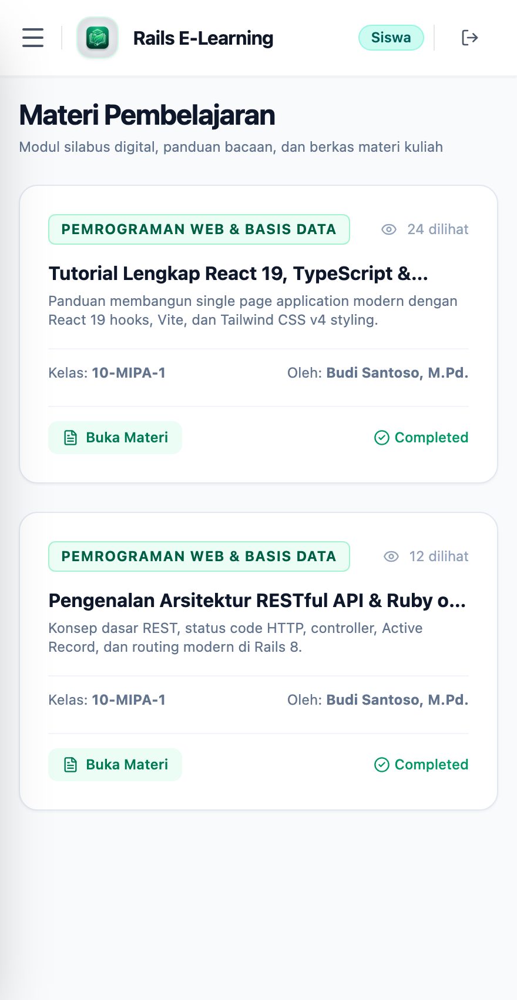 | 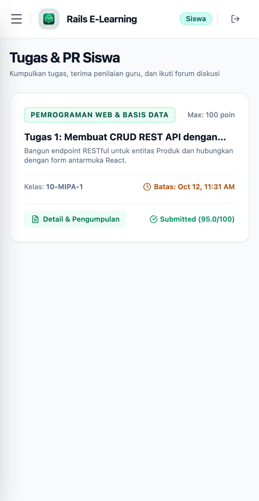 |

| Examination Room | Grades & Report Card |
|:----------------:|:--------------------:|
| 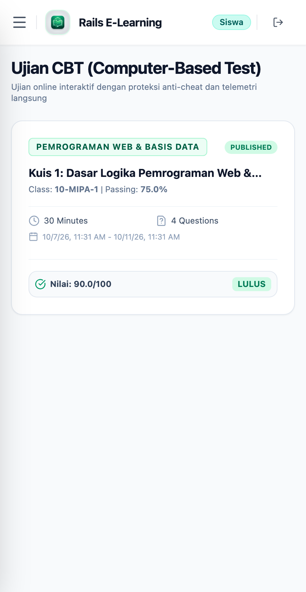 | 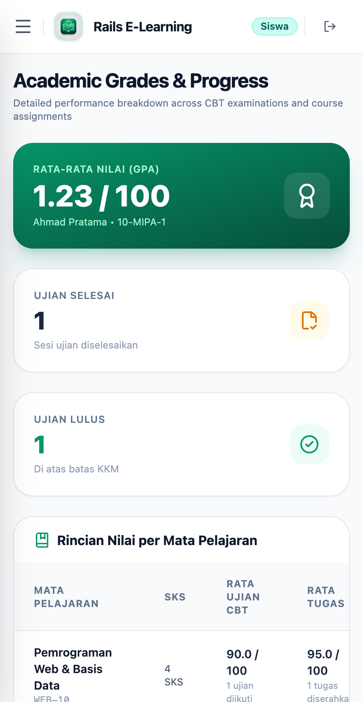 |

---

## 🛠️ Tech Stack

| Layer | Technology |
|---|---|
| **Backend Core** | Ruby 3.3+, Ruby on Rails 8.0 (API Mode) |
| **Security & Auth** | BCrypt, JWT (stateless tokens), Role-based Access Control, Impersonation Engine |
| **Persistence** | PostgreSQL 16, Active Record, Database Migrations |
| **Cache & Realtime** | Redis 7, ActionCable / Redis Telemetry PubSub |
| **Batch Processing** | Roo (`.xlsx`, `.xls`, `.csv` batch parser for Students & Question Banks) |
| **Frontend Core** | React 19, TypeScript 5+, Vite 6 |
| **Styling** | Tailwind CSS v4 (Native CSS engine with `@tailwindcss/vite`) |
| **State Management** | Zustand 5, Axios with JWT interceptors |
| **Testing** | RSpec (`rspec-rails`), FactoryBot, DatabaseCleaner, Oxlint |
| **Deployment & CI** | Docker Compose, Multi-stage Dockerfiles, GitHub Actions CI/CD |

---

## 🚀 Quick Start with Docker Compose

Ensure Docker and Docker Compose are installed on your machine.

```bash
# 1. Clone repository
git clone https://github.com/mfarim/ruby-rails-elearning-react.git
cd ruby-rails-elearning-react

# 2. Copy environment file
cp .env.example .env

# 3. Start all services (Postgres, Redis, Rails Backend, React Frontend)
docker compose up -d --build

# 4. View logs
docker compose logs -f backend
```

Once up, access the applications:
- **Frontend Web Application**: [http://localhost:3002](http://localhost:3002)
- **Backend API**: [http://localhost:8000/health](http://localhost:8000/health)

---

## 💻 Local Development Setup

### Backend (Ruby on Rails 8)
```bash
cd backend

# Install dependencies
bundle install

# Prepare database and seed demo data
bin/rails db:create db:migrate db:seed

# Run RSpec test suite
bundle exec rspec

# Start Puma server on port 8000
PORT=8000 bin/rails server
```

### Frontend (React 19 + Vite)
```bash
cd frontend

# Install dependencies
npm install

# Run linter
npm run lint

# Start Vite dev server on port 3000
npm run dev
```

---

## 🔑 Demo Credentials

| Role | Email | Password |
|---|---|---|
| **Admin** | `admin@elearning.test` | `password123` |
| **Teacher** | `teacher@elearning.test` | `password123` |
| **Student** | `student@elearning.test` | `password123` |

---

## 🔄 CI/CD GitHub Actions

This repository includes continuous integration workflows:
1. **Backend CI (`.github/workflows/backend-ci.yml`)**:
   - Runs on push & PR to `main` for `backend/**`
   - Spawns PostgreSQL 16 & Redis 7 service containers
   - Sets up Ruby 3.3 with Bundler caching
   - Executes database creation, migrations, and seed verification
   - Runs RSpec automated test suite and RuboCop static analysis
2. **Frontend CI (`.github/workflows/frontend-ci.yml`)**:
   - Runs on push & PR to `main` for `frontend/**`
   - Sets up Node.js 20 with npm caching
   - Executes `npm ci`, `oxlint` linting, and production Vite TypeScript build

---

## 📄 License
This project is licensed under the [MIT License](LICENSE).
